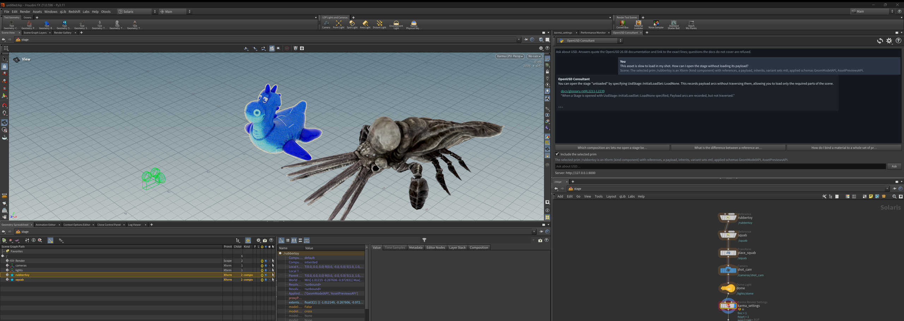
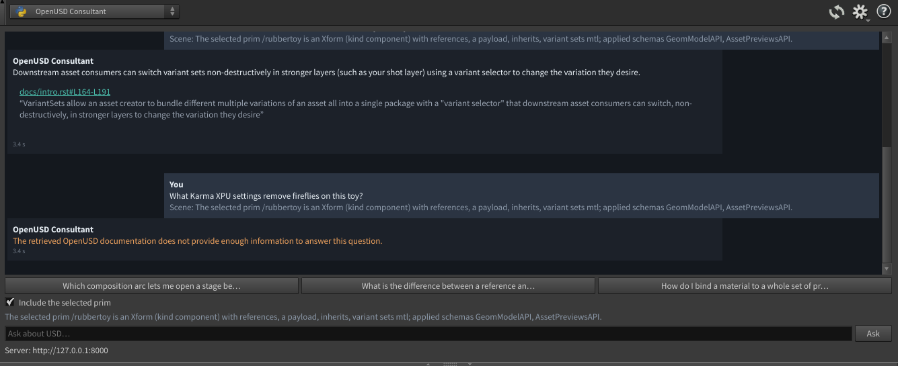

# OpenUSD Docs Assistant

[](https://github.com/orest-zarutskyi/openusd-docs-assistant/actions/workflows/checks.yml)

A question-answering assistant for OpenUSD, built for artists and TDs who work in Solaris. Ask a
question about composition, schemas or the USD toolset, and it answers from the official OpenUSD
26.08 documentation, quotes the passage and links to the exact source lines. When the
documentation does not cover the question, it says so instead of guessing.

It runs as a local API (FastAPI, LangGraph, Qdrant) with a local model through Ollama or Gemini,
and as a chat panel inside Houdini.


## In Houdini



The [Houdini package](integrations/houdini/README.md) adds an **OpenUSD Consultant** tab to the
Parameters pane in Solaris. It can add the prim selected in the viewer to the question: its type,
kind, composition arcs, variant sets and applied schemas. The answer comes back with clickable
links to the documentation lines it quotes, and a question the documentation does not cover is
refused. Requests run on a background thread, so Houdini stays responsive.



Screenshots from Houdini 21.0 with the assistant answering through Gemini 3.5 Flash-Lite. The
scene uses two sample assets that ship with Houdini and is built by
[integrations/houdini/demo](integrations/houdini/demo).

## Results

Measured on real questions from public forums (forum.aousd.org, OpenUSD GitHub issues, the SideFX
and NVIDIA forums, Stack Overflow) that the system never saw while it was tuned. Each set was run
once with frozen settings.

| Set | Model | Answered with valid citations | Unanswerable refused | Fully grounded | Facts covered | p50 |
| --- | --- | --- | --- | --- | --- | --- |
| v3 (60 questions) | **Gemini 3.5 Flash-Lite** | **29 / 42** | **17 / 18** | **97%** | 52% | 4.7 s |
| v3 | qwen3.5:9b, thinking (local) | 20 / 42 | 17 / 18 | 90% | 53% | 21.5 s |
| v3 | qwen3:4b, thinking (local) | 28 / 42 | 13 / 18 | 72% | 38% | 27.1 s |
| v4 (46 questions) | **Gemini 3.5 Flash-Lite** | **23 / 28** | **18 / 18** | **96%** | 64% | 5.1 s |
| v4 | qwen3.5:9b, thinking (local) | 17 / 28 | 17 / 18 | 72% | 42% | 17.5 s |
| v4 | qwen3:4b, thinking (local) | 23 / 28 | 14 / 18 | 92% | 62% | 17.7 s |

- **Valid citation** means every quote in the answer is found in a retrieved passage, ignoring RST
  markup, case and punctuation; a quote stitched from several sentences must match piece by piece.
  The check runs on every answer before it is returned.
- **Fully grounded** and **facts covered** come from a separate LLM judge (`gemini-3.8-flash`),
  calibrated against reference labels (95% agreement on facts, κ 0.85).
- **Gemini Flash-Lite is the recommended configuration.** Across both sets it answered 52 of 70
  answerable questions with valid citations and refused 35 of 36 unanswerable ones, for about
  $0.16 per 100 questions at list price.
- **The local models are an offline option, with a trade-off.** qwen3.5:9b, chosen on dev, answers
  fewer questions; qwen3:4b answers more but claims answers to unanswerable questions more often.
  Neither matches Flash-Lite. A question that is not answered ends as a refusal or as an answer
  the citation check rejected, so it never reaches the user as an unchecked answer.

How the numbers were produced, pass by pass, is in [docs/evaluation.md](docs/evaluation.md).
A one-page summary of the project, including what did not work, is in
[docs/case-study.md](docs/case-study.md).

## How it works

```text
Pinned docs (76 RST files, SHA-256) → chunks with exact line ranges → Qdrant + SQLite FTS5

Question → BM25 + dense (nomic-embed-text) → reciprocal rank fusion → bge-reranker-base
         → refusal gate → LLM (Ollama or Gemini) → quote check → answer with sources
                        ↘ nothing close enough → insufficient_context
```

- **Grounded by construction.** The model must return JSON with an answer and a literal quote for
  each claim. The API accepts the answer only if every quote is found in a retrieved chunk, and
  turns each into a link to the pinned upstream lines.
- **Refusals are a feature.** A question outside the documentation gets `insufficient_context`,
  from the retrieval gate or from the model.
- **Every setting was chosen by a rule fixed in advance.** Retrieval mode, reranker, gate,
  citation check, prompt and model were each compared on a dev set under a selection rule
  committed before the comparison ran, then checked once on a new held-out set. There are 26
  [decision records](docs/decisions/README.md), including the changes that were tested and
  rejected.

## Quick start

Requires Python 3.12, [uv](https://docs.astral.sh/uv/getting-started/installation/) and
[Ollama](https://ollama.com/). Copy `.env.example` to `.env` and set `OPENUSD_QDRANT_PATH=data/qdrant`.

```powershell
uv sync --locked
ollama pull qwen3.5:9b
ollama pull nomic-embed-text:v1.5
uv run --locked openusd-assistant index
uv run --locked openusd-assistant serve
```

Open [localhost:8000](http://127.0.0.1:8000/) for a question page, or
[localhost:8000/docs](http://127.0.0.1:8000/docs) for the API. To answer with Gemini instead, set
`OPENUSD_CHAT_PROVIDER=gemini`, `OPENUSD_GEMINI_MODEL=gemini-3.5-flash-lite` and
`OPENUSD_GEMINI_API_KEY` in `.env`. Keys belong only in `.env`, which Git ignores.

With Docker Desktop and host Ollama running:

```powershell
docker compose up -d --build
docker compose run --rm api index
```

More on setup, snapshots and the evaluation commands: [docs/setup.md](docs/setup.md).

## Limitations

- **Small held-out sets.** v3 contains 42 answerable and 18 unanswerable questions; v4 contains 28
  and 18. A single question shifts a rate by roughly 2–4 percentage points, so small differences
  are inconclusive.
- **Question set and judge calibration.** I wrote the held-out questions based on the OpenUSD
  documentation and real discussions on public platforms, including Reddit, forum.aousd.org,
  OpenUSD GitHub issues, the SideFX and NVIDIA forums, and Stack Overflow. The judge's calibration
  labels were generated by an LLM.
- **Local latency.** With thinking enabled, the local model takes about 20 s per answer and over a
  minute at p95 on an RTX 4070 Ti. Gemini Flash-Lite answers in about 5 s.
- **Retrieval.** This is currently the weakest stage on real questions: nDCG@10 is 0.557 and 0.695
  on the two forum sets. Query rewriting and re-chunking large sections are the next candidates.
- **Scene context.** The Houdini panel adds a sentence about the selected prim to the question, but
  this feature has not been evaluated systematically. In a three-question spot check, the local
  model returned no valid answers; Gemini Flash-Lite answered two and refused the third.
- **Judge API access.** Judge requests went through a third-party API gateway because Gemini's free
  tier allows few judge requests per day. Calibration provides a check on the judge's reliability.

## Source material

The corpus is every RST file under `docs/` in
[OpenUSD 26.08](https://github.com/PixarAnimationStudios/OpenUSD/releases/tag/v26.08) at commit
`ee47c679abde`: 76 documents, 952 chunks ([corpus.md](reports/corpus.md)). See the upstream
[license](https://github.com/PixarAnimationStudios/OpenUSD/blob/ee47c679abde5b467a7b6a41f3b2285564a4222e/LICENSE.txt).
Local data and indexes are reproducible outputs and are ignored by Git.
